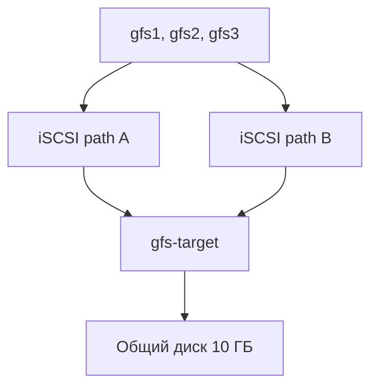

# iSCSI, multipath и общая файловая система GFS2

В этой работе я собрал стенд с общим блочным устройством, которое подключается к трём узлам по iSCSI.

К хранилищу настроено два сетевых пути. На клиентах они объединяются через multipath в одно устройство, поверх которого созданы общий LVM и файловая система GFS2.

Инфраструктура создаётся в Yandex Cloud через Terraform, а настройка серверов выполняется Ansible.

## Схема стенда



В стенде используются четыре виртуальные машины:

| ВМ | Зона | Назначение |
|---|---|---|
| `gfs-target` | `ru-central1-e` | iSCSI target и общий диск |
| `gfs1` | `ru-central1-d` | первый узел GFS2 |
| `gfs2` | `ru-central1-e` | второй узел GFS2 |
| `gfs3` | `ru-central1-d` | третий узел GFS2 |

Изначально я хотел разместить весь стенд в одной зоне, но доступной дисковой квоты для четырёх ВМ и отдельного LUN не хватило. Поэтому часть серверов была перенесена в `ru-central1-e`.

Для каждого iSCSI-клиента используются два сетевых интерфейса. Между подсетями разных зон настроены отдельные маршруты для обоих путей.

## Что получилось

На `gfs-target` настроены:

- дополнительный диск размером 10 ГБ;
- LIO iSCSI target;
- IQN `iqn.2026-10.ru.otus:gfs-target`;
- два портала: `10.50.11.10:3260` и `10.50.12.10:3260`;
- один LUN, доступный через оба портала.

На узлах `gfs1`, `gfs2` и `gfs3` настроены:

- две iSCSI-сессии к одному LUN;
- multipath с политикой `round-robin`;
- общее устройство `/dev/mapper/mpatha`;
- Corosync-кластер из трёх узлов;
- DLM и `lvmlockd`;
- shared VG `vg_gfs2`;
- shared LV `lv_gfs2`;
- GFS2 с тремя журналами;
- общая точка монтирования `/mnt/gfs2`.

SSH разрешён только с публичного адреса, указанного в локальном `terraform.tfvars`. iSCSI и кластерный трафик разрешены только внутри используемых подсетей.

## Структура каталогов

```text
05-iscsi-multipath-gfs2
├── ansible
│   ├── roles
│   │   ├── iscsi_target
│   │   └── gfs2_cluster
│   ├── clients.yml
│   ├── target.yml
│   └── verify-multipath-failover.yml
├── evidence
├── terraform
└── README.md
```

Роль `iscsi_target` настраивает LIO target и оба сетевых портала.

Роль `gfs2_cluster` выполняет настройку клиентов: iSCSI, multipath, Corosync, DLM, shared LVM и GFS2.

Файл `verify-multipath-failover.yml` используется для проверки работы тома при отключении одного iSCSI-пути.

## Требования

Стенд проверялся со следующими версиями:

- Terraform `1.16.3`;
- Yandex Cloud CLI `1.36.0`;
- Ansible Core `2.16.3`;
- WSL 2 с Ubuntu 24.04;
- образ Ubuntu 24.04 для виртуальных машин.

Также нужен SSH-ключ. По умолчанию OpenSSH использует ключ `~/.ssh/id_ed25519`.

## Авторизация Terraform

Для работы Terraform использовался сервисный аккаунт `terraform-otus` и временный IAM-токен:

```powershell
$folderId = (yc config get folder-id).Trim()

$serviceAccountId = (
    yc iam service-account get `
        --name terraform-otus `
        --folder-id $folderId `
        --format json |
    ConvertFrom-Json
).id

$env:YC_TOKEN = (
    yc iam create-token `
        --impersonate-service-account-id $serviceAccountId
).Trim()

$env:YC_CLOUD_ID = (yc config get cloud-id).Trim()
$env:YC_FOLDER_ID = $folderId
```

Токен находится только в переменной текущей PowerShell-сессии и в репозиторий не сохраняется.

## Настройка разрешённого SSH-адреса

Перед запуском Terraform создаётся локальный `terraform.tfvars`:

```powershell
Set-Location ".\terraform"

$currentIp = (
    Invoke-RestMethod -Uri "https://api.ipify.org"
).ToString().Trim()

"ssh_allowed_cidr = `"$currentIp/32`"" |
    Set-Content `
        -Path ".\terraform.tfvars" `
        -Encoding utf8
```

`terraform.tfvars`, state-файлы, планы и каталог `.terraform` исключены из Git.

## Создание инфраструктуры

```powershell
Set-Location ".\terraform"

terraform init
terraform fmt -recursive
terraform validate
terraform plan -out=gfs2.tfplan
terraform apply "gfs2.tfplan"
```

После создания Terraform выводит публичные адреса серверов, внутренние адреса обоих путей и готовый Ansible inventory.

## Создание Ansible inventory

Команду нужно выполнять из каталога `terraform`:

```powershell
$inventoryPath = Join-Path `
    -Path (Resolve-Path "..\ansible").Path `
    -ChildPath "inventory.ini"

$inventoryLines = @(
    terraform output -raw ansible_inventory
)

$inventoryContent = (
    [string]::Join(
        [Environment]::NewLine,
        $inventoryLines
    )
).TrimEnd() + [Environment]::NewLine

[System.IO.File]::WriteAllText(
    $inventoryPath,
    $inventoryContent,
    [System.Text.UTF8Encoding]::new($false)
)
```

Inventory содержит временные публичные IP, поэтому он не добавляется в Git.

## Запуск Ansible

Команды ниже выполняются из корня этой домашней работы:

```powershell
Set-Location `
    "."
```

Сначала проверяется подключение:

```powershell
wsl bash -lc "cd ansible && ansible all -i inventory.ini -m ping"
```

Затем настраивается iSCSI target:

```powershell
wsl bash -lc "cd ansible && ansible-playbook -i inventory.ini target.yml"
```

После этого настраиваются три клиента:

```powershell
wsl bash -lc "cd ansible && ansible-playbook -i inventory.ini clients.yml"
```

Повторный запуск `clients.yml` завершился без изменений:

```text
gfs1 : changed=0 failed=0
gfs2 : changed=0 failed=0
gfs3 : changed=0 failed=0
```

## Результат проверки

На каждом клиенте создаются две iSCSI-сессии:

```text
10.50.11.10:3260
10.50.12.10:3260
```

Оба пути объединяются в одно устройство:

```text
mpatha (360014050a83af549213459ab44052062) dm-0 LIO-ORG,gfs_lun
size=10G
|- sda active ready running
`- sdb active ready running
```

Corosync видит все три узла:

```text
Expected votes: 3
Total votes:    3
Quorum:         2
Quorate:        Yes
```

Общий том смонтирован на всех узлах:

```text
/mnt/gfs2 /dev/mapper/vg_gfs2-lv_gfs2 gfs2 rw,noatime,rgrplvb
```

Каждый узел создал на нём свой тестовый файл. На всех трёх ВМ виден один и тот же набор:

```text
gfs1.txt
gfs2.txt
gfs3.txt
```

## Проверка отказа одного пути

Для проверки использовался отдельный playbook:

```powershell
wsl bash -lc "cd ansible && ansible-playbook -i inventory.ini verify-multipath-failover.yml"
```

На `gfs1` временно отключался путь через `10.50.11.10`.

После отключения остались:

```text
Sessions to target: 1
Active multipath paths: 1
```

GFS2 при этом остался смонтированным. На общий том удалось записать файл:

```text
File written on gfs1 while one iSCSI path was disconnected.
```

После теста отключённый путь автоматически подключился обратно:

```text
Restored sessions to target: 2
Restored active paths: 2
```

Файл, созданный во время проверки, виден с `gfs1`, `gfs2` и `gfs3`.

## Результаты команд

В каталоге `evidence` сохранены:

- Terraform plan и список ресурсов;
- Terraform outputs;
- проверка подключения Ansible;
- результат повторного запуска Ansible;
- состояние iSCSI target;
- состояние multipath, Corosync, LVM и GFS2;
- результат проверки отказа одного iSCSI-пути.

## Удаление стенда

После завершения проверки ресурсы удаляются:

```powershell
Set-Location ".\terraform"
terraform destroy
```

После удаления дополнительно проверяется, что Terraform state больше не содержит ресурсов:

```powershell
terraform state list
```